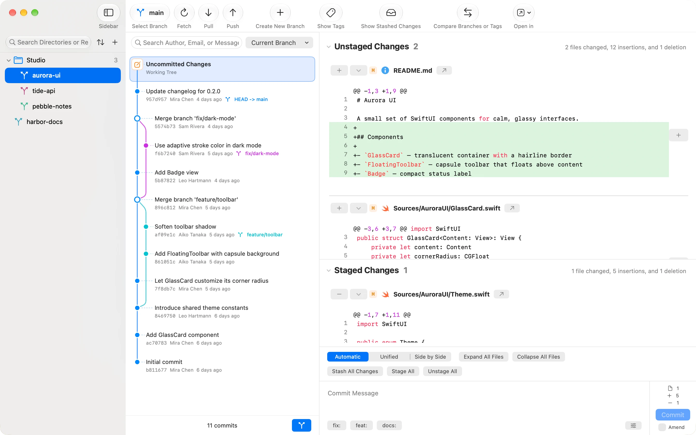

<p align="center">
  <picture>
    <source media="(prefers-color-scheme: dark)" srcset="Shared/Resources/Branding/Images/FoldGit-dark.png">
    
  </picture>
</p>

<h1 align="center">FoldGit</h1>

<p align="center">
  Every repository, folded into one window.<br>
  A native, lightweight Git client for macOS.
</p>

<p align="center">
  <b>English</b> · <a href="README.zh-CN.md">简体中文</a>
</p>

<picture>
  <source media="(prefers-color-scheme: dark)" srcset="website/assets/screenshots/main-en-dark@2x.webp">
  
</picture>

## Why FoldGit

More and more code is written by AI agents, and reviewing changes rarely needs an IDE anymore. Production code still deserves a human look: which files changed, which lines moved, whether anything went out of bounds.

FoldGit is a small, quiet window for exactly that. It keeps all your repositories at hand, shows changes clearly, and follows the look and feel of macOS. Existing Git clients rarely manage to be beautiful, simple and lightweight at once, and similar projects had drifted too far in interaction and internals to adjust from within, so FoldGit started fresh.

## Features

- **Fold repositories, not folders.** Every repository stays in the sidebar. Import a folder and its repositories become a group, or create groups that gather repositories from anywhere. Groups never move anything on disk. Rarely used repositories fold one level deeper.
- **Worktrees, first-class.** Linked worktrees are discovered automatically and appear under their repository with the branch name. Create, move, lock, remove and prune them, and use *Finish Worktree* to merge into a target branch and clean up. Conflicts are resolved in native sheets.
- **Review and commit.** Commit graph, unified and side-by-side diffs (switching automatically with the window width), hunk staging, amend, and commit message templates.
- **Branches, tags and comparison.** Switch, merge, rename and delete branches, manage tags, and compare any two branches or tags.
- **Fast search.** Filter history by author, email or message as you type. Search runs in the background, reuses its index, pages results and cancels stale queries. It works with CJK input methods.
- **Sidebar that scales.** Filter by folder, repository or custom display name. Sort by name, recently opened, modified or added, or keep a manual order.
- **Everyday extras.** Stash, per-repository Auto Fetch (download only, never merge), *Open in* your editor or terminal, light and dark appearances, and eight interface languages.
- **Native and small.** Written in SwiftUI and AppKit, no Electron. The installer is about 4 MB.

## Install

Requires an Apple Silicon Mac running macOS 26 or later, and Git. If Git is missing, run `xcode-select --install`.

1. Download the latest `FoldGit-…-macOS-arm64.dmg` from [Releases](https://github.com/dufu1991/foldgit/releases/latest).
2. Open the DMG and drag FoldGit into Applications.
3. FoldGit is not yet signed with an Apple Developer certificate, so macOS may say it is damaged or cannot be verified on first launch. Run this once, then open it again:

   ```sh
   xattr -dr com.apple.quarantine /Applications/FoldGit.app
   ```

A short user guide lives in [website/manual.html](website/manual.html).

## Windows

The repository also contains a Windows client built with C#, WinUI 3 and .NET 10 (Windows 11 24H2 or later, x64 and ARM64). It is only a minimal implementation, and the author has no Windows machine to polish it on. Contributions are very welcome: see the [Windows guide](Platforms/Windows/README.md) and the [feature parity checklist](docs/WINDOWS_PARITY.md).

## Development

### Repository layout

```text
Package.swift                 Shared Swift package entry
Package.resolved              Shared dependency lock
Shared/
  Sources/FoldGitCore/        Platform-independent Git and domain core
  Resources/Branding/         Shared icon sources, vector layers and images
  Resources/FileIcons/        Shared file type icons and matching rules
  Resources/Localization/     Source strings for eight languages
  Resources/Licenses/         Project and third-party licenses
  Fixtures/                   Cross-language behavior samples
  Testing/                    Reusable temporary-repository test helpers
  Tests/FoldGitCoreTests/     Shared core tests
Platforms/
  macOS/                      Native macOS app and all of its private files
    Sources/                  SwiftUI, AppKit, state and system services
    Resources/                Localizations and Apple asset catalogs
    Configuration/            App identity, signing and export settings
    Tests/                    macOS UI and integration tests
    FoldGit.xcodeproj/        Xcode project
    project.yml               XcodeGen spec
  Windows/                    WinUI 3 app, C# core, system adapters and MSIX packaging
Scripts/                      Repository-level validation tools
website/                      Landing page and user guide (static)
.github/                      Build workflows for the core and each platform
docs/                         Architecture and migration notes
```

The shared module does not depend on AppKit, SwiftUI, Foundation Models or macOS preferences. The macOS app consumes it as a local Swift package instead of compiling shared sources into the app target.

### Shared core

Use Swift 6.2 or later with Git on `PATH`. From the repository root:

```sh
swift test
python3 Scripts/check-platform-boundaries.py
```

CI validates the shared core, the Windows core and the macOS app separately.

### macOS app

Apple Silicon only, macOS 26 minimum. Verified with Xcode 27.1 and Swift 6.4. Open `Platforms/macOS/FoldGit.xcodeproj`.

Local Debug builds and tests use a fixed Apple Development certificate, so macOS keeps recognizing existing file access permissions across rebuilds. Copy `Platforms/macOS/Configuration/LocalSigning.xcconfig.example` to `LocalSigning.xcconfig` in the same folder and fill in your team ID (the `OU` field of the certificate subject). The file is git-ignored. You can set `CODE_SIGN_IDENTITY` to the certificate's SHA-1 fingerprint to pin a specific certificate. Keep the same bundle ID and app path while developing, and do not pass `CODE_SIGNING_ALLOWED=NO`; switching signing for the first time may ask for permission once. CI builds that never launch the app may still disable signing.

```sh
xcodebuild test -project Platforms/macOS/FoldGit.xcodeproj -scheme FoldGit \
  -configuration Debug -destination 'platform=macOS'

python3 Scripts/generate-resources.py --check
python3 Scripts/validate-localizations.py
```

Regenerate the Xcode project with XcodeGen 2.45 or later:

```sh
xcodegen generate --spec Platforms/macOS/project.yml
```

### Icons and local packaging

Shared brand assets live in `Shared/Resources/Branding`. macOS uses the layered icon directly; other platforms use the PNG and SVG layers next to it.

Build a local Apple Silicon (`arm64`) Release package:

```sh
Scripts/package-macos.sh
```

Output goes to `dist/macos`: `FoldGit.app`, a DMG and ZIP named `macOS-arm64`, and SHA-256 checksums. The local script uses ad hoc signing and does not notarize.

### App identity and releases

The macOS app is `FoldGit`, bundle ID `com.dufu.foldgit`. The Windows package identity is `dufu.FoldGit` with publisher `CN=dufu`. Signing settings live in `Platforms/macOS/Configuration`.

The version lives in three places that must match: `MARKETING_VERSION` in `Platforms/macOS/Configuration/Base.xcconfig`, the Windows `Package.appxmanifest`, and the Windows About text. `Scripts/version.py` keeps them in sync:

```sh
python3 Scripts/version.py            # print the version and check that all platforms match
python3 Scripts/version.py set 0.2.0  # set a new version and bump the macOS build number
```

Commit and push the new version to `main`, and the [release workflow](.github/workflows/release.yml) builds the macOS DMG and ZIP and the Windows x64 and ARM64 MSIX, then publishes them as release `v0.2.0` with checksums. Pushing a version that already has a tag does nothing. Run the workflow manually with *rebuild* to replace the assets of an existing release.

Signing secrets are optional:

| Secrets | Without them |
|---|---|
| `APPLE_TEAM_ID`, `BUILD_CERTIFICATE_BASE64`, `P12_PASSWORD`, `KEYCHAIN_PASSWORD`, `AC_USERNAME`, `AC_PASSWORD` | The macOS app is ad hoc signed and not notarized; users clear the quarantine flag once. |
| `WINDOWS_CERTIFICATE_BASE64`, `WINDOWS_CERTIFICATE_PASSWORD` (a PFX whose subject is `CN=dufu`) | Each MSIX is signed with a throwaway self-signed certificate, published next to it as a `.cer` for users to trust. |

### Website

`website/` is a static landing page and user guide with no build step. See [website/README.md](website/README.md) for local preview and how screenshots are regenerated from fictional demo repositories.

More reading: [Architecture](docs/ARCHITECTURE.md), [Migration notes](docs/MIGRATION.md), [Localization guide](docs/LOCALIZATION.md).

## License

FoldGit is an open source project independently maintained by dufu, released under the [MIT License](LICENSE). Copyright of the project's own code belongs to dufu.

Third-party code, Swift Subprocess, Swift System and Material Icon Theme keep their own copyright and license notices. The full text is in [Shared/Resources/Licenses/LICENSE.txt](Shared/Resources/Licenses/LICENSE.txt), ships with the macOS app, and can be viewed under Open Source Licenses in Settings.
