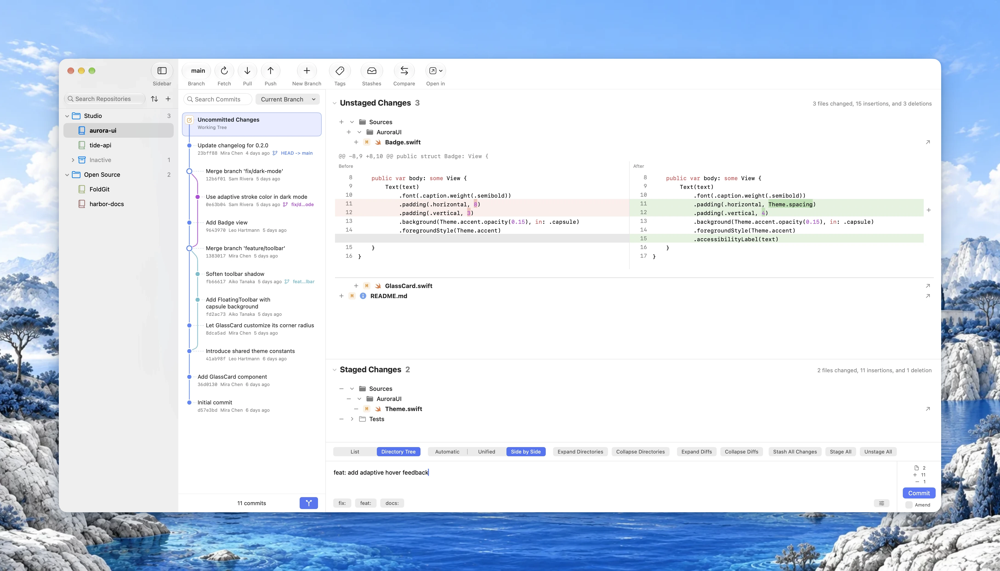
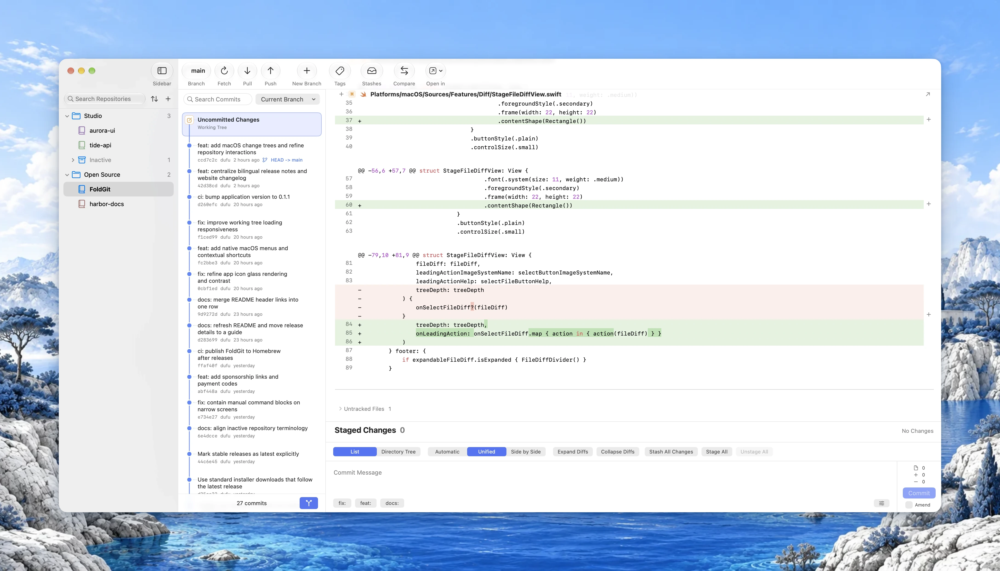

<p align="center">
  <picture>
    <source media="(prefers-color-scheme: dark)" srcset="Shared/Resources/Branding/Images/FoldGit-dark.png">
    
  </picture>
</p>

<h1 align="center">FoldGit</h1>

<p align="center">
  Every repository, folded into one window.<br>
  A native, lightweight Git client for macOS.
</p>

<p align="center">
  <a href="https://foldgit.com">Website</a> · <a href="https://foldgit.com/manual">User guide</a> · <a href="README.zh-CN.md">简体中文</a>
</p>

<picture>
  <source media="(prefers-color-scheme: dark)" srcset="website/assets/showcases/main-en-dark@2x.webp">
  
</picture>

## Why FoldGit

More and more code is written by AI agents, and reviewing changes rarely needs an IDE anymore. Production code still deserves a human look: which files changed, which lines moved, whether anything went out of bounds.

FoldGit is a small, quiet window for exactly that. It keeps all your repositories at hand, shows changes clearly, and follows the look and feel of macOS. Existing Git clients rarely manage to be beautiful, simple and lightweight at once, and similar projects had drifted too far in interaction and internals to adjust from within, so FoldGit started fresh.

## Features

- **Fold repositories, not folders.** Every repository stays in the sidebar. Import a folder and its repositories become a group, or create groups that gather repositories from anywhere. Groups never move anything on disk. Inactive repositories fold one level deeper.
- **Worktrees, first-class.** Linked worktrees are discovered automatically and appear under their repository with the branch name. Create, move, lock, remove and prune them, and use *Finish Worktree* to merge into a target branch and clean up. Conflicts are resolved in native sheets.
- **Review and commit.** Commit graph for the current branch or all commits, unified and side-by-side diffs (switching automatically with the window width), hunk staging, amend, revert, and commit message templates.
- **Branches, tags and comparison.** Switch, merge, rename and delete branches, manage tags, and compare any two branches or tags.
- **Native menus and shortcuts.** Open recent repositories, run repository and commit actions, navigate to HEAD, and control diff views from the menu bar. Find the shortcut reference under Help.
- **Fast search.** Filter history by author, email or message as you type. Search runs in the background, reuses its index, pages results and cancels stale queries. It works with CJK input methods.
- **Sidebar that scales.** Filter by folder, repository or custom display name. Sort by name, recently opened, modified or added, or keep a manual order.
- **Everyday extras.** Push and pull, stash, per-repository Auto Fetch (download only, never merge), *Open in* your editor or terminal, light and dark appearances, and eight interface languages.
- **Native and small.** Written in SwiftUI and AppKit, no Electron. The installer is about 4 MB.

Reviewing FoldGit’s own development changes in the expanded unified diff view:

<picture>
  <source media="(prefers-color-scheme: dark)" srcset="website/assets/showcases/foldgit-en-dark@2x.webp">
  
</picture>

## Install

Requires an Apple Silicon Mac running macOS 26 or later, and Git. If Git is missing, run `xcode-select --install`.

### Homebrew

With [Homebrew](https://brew.sh/) installed:

```sh
brew install --cask dufu1991/tap/foldgit
```

To update, run `brew update` followed by `brew upgrade --cask dufu1991/tap/foldgit`.

### Download the DMG

1. Download the latest `FoldGit-macOS-arm64.dmg` from [Releases](https://github.com/dufu1991/foldgit/releases/latest).
2. Open the DMG and drag FoldGit into Applications.

### First launch

Releases that are not notarized by Apple carry this command in their release notes. If macOS says FoldGit is damaged or cannot be verified, run it once, then open FoldGit again:

```sh
xattr -dr com.apple.quarantine /Applications/FoldGit.app
```

### User guide

See the [user guide](https://foldgit.com/manual) on foldgit.com.

## Windows

The repository also contains a Windows client built with C#, WinUI 3 and .NET 10 (Windows 11 24H2 or later, x64 and ARM64). It is only a minimal implementation, and the author has no Windows machine to polish it on. Contributions are very welcome: see the [Windows guide](Platforms/Windows/README.md) and the [feature parity checklist](docs/WINDOWS_PARITY.md).

Download the Windows x64 or ARM64 EXE from [Releases](https://github.com/dufu1991/foldgit/releases/latest), then open it to install. Required runtimes are included.

## Support FoldGit

FoldGit is independently developed and maintained by dufu. If it makes reviewing code and managing repositories easier for you, a donation helps support ongoing development and maintenance. Thank you for your support!

- [Buy Me a Coffee](https://www.buymeacoffee.com/dufu1991)
- [PayPal](https://paypal.me/dufu1991)

You can also scan a QR code with WeChat or Alipay. Click an image to view it at full size.

<table>
  <tr><th>WeChat Pay</th><th>Alipay</th></tr>
  <tr>
    <td><a href="website/assets/sponsor/wechat.png"></a></td>
    <td><a href="website/assets/sponsor/alipay.png"></a></td>
  </tr>
</table>

## Development

### Repository layout

```text
Package.swift                 Shared Swift package entry
Package.resolved              Shared dependency lock
Shared/
  Sources/FoldGitCore/        Platform-independent Git and domain core
  Resources/Branding/         Shared icon sources, vector layers and images
  Resources/FileIcons/        Shared file type icons and matching rules
  Resources/Localization/     Source strings for eight languages
  Resources/Licenses/         Project and third-party licenses
  Fixtures/                   Cross-language behavior samples
  Testing/                    Reusable temporary-repository test helpers
  Tests/FoldGitCoreTests/     Shared core tests
Platforms/
  macOS/                      Native macOS app and all of its private files
    Sources/                  SwiftUI, AppKit, state and system services
    Resources/                Localizations and Apple asset catalogs
    Configuration/            App identity, signing and export settings
    Tests/                    macOS UI and integration tests
    Screenshots/              macOS app screenshots
    FoldGit.xcodeproj/        Xcode project
    project.yml               XcodeGen spec
  Windows/                    WinUI 3 app, C# core, system adapters and installer packaging
Scripts/                      Resource generation, validation and packaging tools
website/                      Landing page and user guide (static)
.github/                      Build workflows for the core and each platform
docs/                         Architecture, migration and release notes
```

The shared module does not depend on AppKit, SwiftUI or macOS preferences. The macOS app consumes it as a local Swift package instead of compiling shared sources into the app target.

### Shared core

Use Swift 6.2 or later with Git on `PATH`. From the repository root:

```sh
swift test
python3 Scripts/check-platform-boundaries.py
python3 Scripts/validate-windows.py   # Windows inputs that can be checked without the XAML compiler
```

CI validates the shared core, the Windows core and the macOS app separately.

### macOS app

Apple Silicon only, macOS 26 minimum. Verified with Xcode 27.1 and Swift 6.4. Open `Platforms/macOS/FoldGit.xcodeproj`.

Local Debug builds and tests use a fixed Apple Development certificate, so macOS keeps recognizing existing file access permissions across rebuilds. Copy `Platforms/macOS/Configuration/LocalSigning.xcconfig.example` to `LocalSigning.xcconfig` in the same folder and fill in your team ID (the `OU` field of the certificate subject). The file is git-ignored. You can set `CODE_SIGN_IDENTITY` to the certificate's SHA-1 fingerprint to pin a specific certificate. Keep the same bundle ID and app path while developing, and do not pass `CODE_SIGNING_ALLOWED=NO`; switching signing for the first time may ask for permission once. CI builds that never launch the app may still disable signing.

```sh
xcodebuild test -project Platforms/macOS/FoldGit.xcodeproj -scheme FoldGit \
  -configuration Debug -destination 'platform=macOS'

python3 Scripts/generate-resources.py --check
python3 Scripts/validate-localizations.py
```

Regenerate the Xcode project with XcodeGen 2.45 or later:

```sh
xcodegen generate --spec Platforms/macOS/project.yml
```

### Icons and local packaging

Shared brand assets live in `Shared/Resources/Branding`. macOS uses the layered icon directly; other platforms use the PNG and SVG layers next to it.

Build a local Apple Silicon (`arm64`) Release package:

```sh
Scripts/package-macos.sh
```

Output goes to `dist/macos`: `FoldGit.app`, a DMG and ZIP named `macOS-arm64`, and SHA-256 checksums. The local script uses ad hoc signing and does not notarize.

### Releases

Set the version with `python3 Scripts/version.py set <version>` and push to `main`; the [release workflow](.github/workflows/release.yml) publishes the macOS DMG and Windows EXE installers. The Homebrew tap automatically checks for new releases every 6 hours and updates the cask using its own `GITHUB_TOKEN`, without a personal access token. GitHub scheduling may delay a run. Versioning, Homebrew synchronization and optional signing secrets are described in the [release guide](docs/RELEASING.md).

### Website

`website/` is the static landing page and user guide published at [foldgit.com](https://foldgit.com), with no build step. See [website/README.md](website/README.md) for local preview and how screenshots are captured from demo repositories and FoldGit itself.

More reading: [Architecture](docs/ARCHITECTURE.md), [Migration notes](docs/MIGRATION.md), [Localization guide](docs/LOCALIZATION.md), [File icons](docs/FILE_ICONS.md), [Windows parity checklist](docs/WINDOWS_PARITY.md), [Release guide](docs/RELEASING.md). Notes under `docs/` are written in Chinese.

## License

FoldGit is an open source project independently maintained by dufu, released under the [MIT License](LICENSE). Copyright of the project's own code belongs to dufu.

Third-party code, Swift Subprocess, Swift System and Material Icon Theme keep their own copyright and license notices. The full text is in [Shared/Resources/Licenses/LICENSE.txt](Shared/Resources/Licenses/LICENSE.txt), ships with the macOS app, and can be viewed under Open Source Licenses in Settings.
