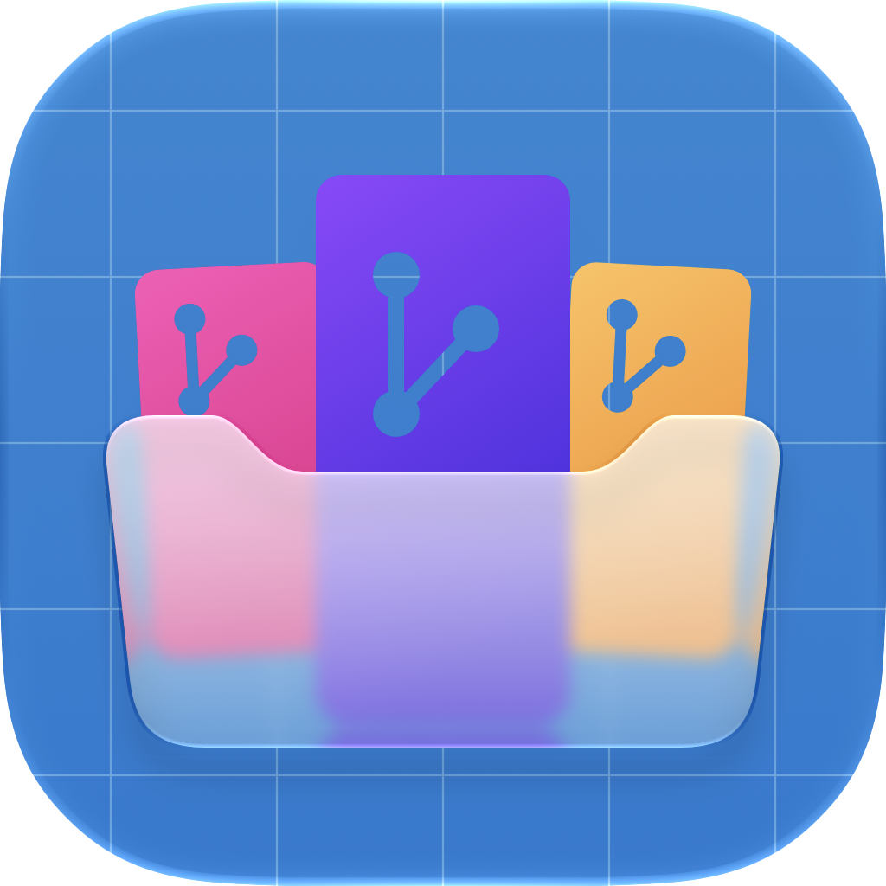
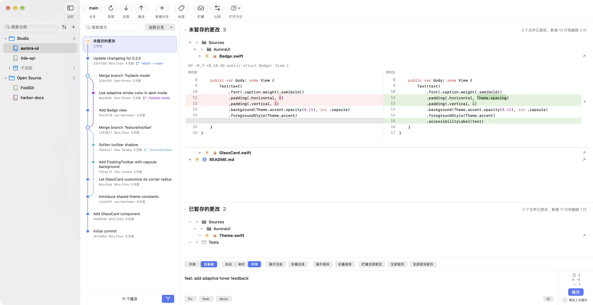

<p align="center">
  <picture>
    <source media="(prefers-color-scheme: dark)" srcset="Shared/Resources/Branding/Images/FoldGit-dark.png">
    
  </picture>
</p>

<h1 align="center">FoldGit</h1>

<p align="center">
  把所有仓库，折进一个窗口。<br>
  原生、轻量的 macOS Git 客户端。
</p>

<p align="center">
  <a href="README.md">English</a> · <b>简体中文</b>
</p>

<picture>
  <source media="(prefers-color-scheme: dark)" srcset="website/assets/screenshots/main-zh-dark@2x.webp">
  
</picture>

## 为什么做 FoldGit

越来越多的代码由 AI Agent 生成，查看改动常常不必再打开 IDE。但生产代码仍需要有人过一遍：改了哪些文件、动了哪几行、有没有越界。

FoldGit 就是为此准备的一个轻巧、安静的窗口：所有仓库随手可及，改动看得清楚，界面遵循 macOS 的视觉习惯。现有 Git 客户端很难同时做到美观、简洁和轻量；方向相近的项目也有，但交互和底层都已偏离太远，不适合在原项目里调整，于是重新开始。

## 功能

- **折叠仓库，而不是移动文件夹。** 所有仓库常驻侧边栏。导入一个目录，其中的仓库自动成组；也可以新建分组，把不同位置的仓库收在一起。分组不会移动任何文件夹，不活跃的仓库可以再折一层。
- **工作树是一等公民。** 自动发现关联工作树，带着分支名显示在所属仓库下方。支持新建、移动、锁定、移除和清理缺失记录；「完成工作树」可合并到目标分支并收尾清理。合并冲突在原生弹窗中处理。
- **查看与提交。** 提交图，单栏与双栏差异（随窗口宽度自动切换），代码块暂存，修改上次提交，提交信息模板。
- **分支、标签与比较。** 切换、合并、重命名和删除分支，管理标签，比较任意两个分支或标签。
- **快速搜索。** 按作者、邮箱或提交信息实时筛选历史。搜索在后台进行，复用索引、分页返回，新输入会取消旧查询，支持中文输入法上屏后触发。
- **仓库多了也不乱。** 可按目录名、仓库文件夹名或自定义显示名称过滤；可按名称、最近打开、最近修改、最近添加排序，或保留手动顺序。
- **日常所需。** Stash，按仓库设置的自动抓取（只下载、不合并），在编辑器或终端中打开，亮暗色外观，八种界面语言。
- **原生且小巧。** SwiftUI 与 AppKit 原生实现，不含 Electron，安装包约 4 MB。

## 安装

需要 macOS 26 及以上的 Apple Silicon Mac，并已安装 Git。没有 Git 的话，运行 `xcode-select --install`。

1. 在 [Releases](https://github.com/dufu1991/foldgit/releases/latest) 下载最新的 `FoldGit-macOS-arm64.dmg`。
2. 打开 DMG，把 FoldGit 拖进「应用程序」。
3. FoldGit 暂未使用 Apple 开发者证书签名，首次打开时 macOS 可能提示“已损坏”或“无法验证开发者”。在终端执行一次下面的命令，再重新打开即可：

   ```sh
   xattr -dr com.apple.quarantine /Applications/FoldGit.app
   ```

简短的使用手册见 [website/manual.html](website/manual.html)。

## Windows 版

仓库中还包含一个基于 C#、WinUI 3 和 .NET 10 的 Windows 客户端（Windows 11 24H2 及以上，x64 与 ARM64）。它目前只是最简实现，作者没有 Windows 设备，无法继续打磨。非常欢迎感兴趣的你参与建设：开发步骤见 [Windows 说明](Platforms/Windows/README.md)，实机验收项见 [功能对齐清单](docs/WINDOWS_PARITY.md)。

在 [Releases](https://github.com/dufu1991/foldgit/releases/latest) 下载 Windows x64 或 ARM64 的 EXE，双击安装即可，无需另行下载运行时。

## 支持 FoldGit

FoldGit 由 dufu 独立开发和维护。如果它让你查看代码、管理仓库更轻松，欢迎通过赞助支持后续开发与维护。感谢每一份支持！

- [Buy Me a Coffee](https://www.buymeacoffee.com/dufu1991)
- [PayPal](https://paypal.me/dufu1991)

海外用户可使用上述链接，国内用户可通过微信或支付宝扫码赞助。点击二维码可查看原图。

<table>
  <tr><th>微信赞赏</th><th>支付宝收款</th></tr>
  <tr>
    <td><a href="website/assets/sponsor/wechat.png"></a></td>
    <td><a href="website/assets/sponsor/alipay.png"></a></td>
  </tr>
</table>

## 开发

### 目录结构

```text
Package.swift                 共享 Swift Package 入口
Package.resolved              共享依赖锁定
Shared/
  Sources/FoldGitCore/        平台无关的 Git 与业务核心
  Resources/Branding/         共享图标源文件、矢量图层与通用图片
  Resources/FileIcons/        共享文件类型图标与匹配规则
  Resources/Localization/     八种语言的文案源目录
  Resources/Licenses/         项目许可与第三方许可声明
  Fixtures/                   跨语言行为样例
  Testing/                    可复用的临时仓库测试工具
  Tests/FoldGitCoreTests/     独立共享核心测试
Platforms/
  macOS/                      原生 macOS 应用及其全部私有文件
    Sources/                  SwiftUI、AppKit、状态绑定和系统服务
    Resources/                本地化与 Apple 资源目录
    Configuration/            应用标识、签名和导出配置
    Tests/                    macOS 界面与系统集成测试
    FoldGit.xcodeproj/        Xcode 工程
    project.yml               macOS 工程生成配置
  Windows/                    WinUI 3 应用、C# 核心、系统适配与 MSIX 打包
Scripts/                      仓库级校验工具
website/                      落地页与使用手册（静态页面）
.github/                      共享核心与平台构建工作流
docs/                         架构与迁移文档
```

共享模块不依赖 AppKit、SwiftUI、Foundation Models 或 macOS 偏好存储。macOS 应用通过本地 Swift Package 依赖引用核心，不把共享源码重复编译到应用模块。

### 共享核心

使用 Swift 6.2 或更新版本，并确保 Git 位于 `PATH` 中。在项目根目录执行：

```sh
swift test
python3 Scripts/check-platform-boundaries.py
```

CI 分别验证共享核心、Windows 共享核心和 macOS 应用。

### macOS 应用

仅支持 Apple Silicon Mac，最低系统版本为 macOS 26，使用 Xcode 27.1、Swift 6.4 验证。打开 `Platforms/macOS/FoldGit.xcodeproj` 开发。

本地 Debug 构建和测试使用固定的 Apple Development 证书，以便 macOS 在重新构建后继续识别已有的文件访问授权。首次配置时，将 `Platforms/macOS/Configuration/LocalSigning.xcconfig.example` 复制为同目录下的 `LocalSigning.xcconfig`，填写证书的团队标识（证书主题中的 `OU` 字段）。该文件已加入 Git 忽略列表，可以把 `CODE_SIGN_IDENTITY` 设置为证书的 SHA-1 指纹以固定具体证书。开发时保持相同的 Bundle ID 和应用路径，构建命令不要传入 `CODE_SIGNING_ALLOWED=NO`；首次切换签名可能需要重新授权一次。CI 中不启动交互式应用的构建仍可显式禁用签名。

```sh
xcodebuild test -project Platforms/macOS/FoldGit.xcodeproj -scheme FoldGit \
  -configuration Debug -destination 'platform=macOS'

python3 Scripts/generate-resources.py --check
python3 Scripts/validate-localizations.py
```

使用 XcodeGen 2.45 或更新版本重新生成 macOS 工程：

```sh
xcodegen generate --spec Platforms/macOS/project.yml
```

### 图标与本地打包

共享品牌资源位于 `Shared/Resources/Branding`。macOS 直接引用分层图标，其他平台可使用同目录的通用 PNG 与 SVG 图层。

生成仅含 Apple Silicon（`arm64`）架构的本地 Release 安装包：

```sh
Scripts/package-macos.sh
```

产物位于 `dist/macos`，包含 `FoldGit.app`、以 `macOS-arm64` 命名的 DMG 和 ZIP，以及 SHA-256 校验文件。本地脚本使用 ad hoc 签名，不执行 Apple 公证。

### 应用身份与发布

macOS 应用名为 `FoldGit`，Bundle ID 为 `com.dufu.foldgit`；Windows 包身份为 `dufu.FoldGit`，Publisher 为 `CN=dufu`。签名配置位于 `Platforms/macOS/Configuration`。

版本号分布在三处且必须一致：`Platforms/macOS/Configuration/Base.xcconfig` 中的 `MARKETING_VERSION`、Windows 的 `Package.appxmanifest`，以及 Windows「关于」页的文字。用 `Scripts/version.py` 统一修改：

```sh
python3 Scripts/version.py            # 显示版本号，并检查各平台是否一致
python3 Scripts/version.py set 0.2.0  # 设置新版本，并递增 macOS 构建号
```

提交并推送到 `main` 后，[发布工作流](.github/workflows/release.yml)会为 `v0.2.0` 仅发布三个安装包：macOS Apple Silicon 的 DMG，以及 Windows x64 和 ARM64 各一个 EXE。SHA-256 校验值写入发布说明。附件使用固定文件名，官网下载链接会自动指向最新版本。推送已有标签的版本不会重复发布；如需替换已发布版本的安装包，可手动运行工作流并勾选 *rebuild*。

签名所需的 Secrets 均为可选：

| Secrets | 未配置时 |
|---|---|
| `APPLE_TEAM_ID`、`BUILD_CERTIFICATE_BASE64`、`P12_PASSWORD`、`KEYCHAIN_PASSWORD`、`AC_USERNAME`、`AC_PASSWORD` | macOS 使用 ad hoc 签名，不经公证；用户首次打开前需清除隔离标记。 |
| `WINDOWS_CERTIFICATE_BASE64`、`WINDOWS_CERTIFICATE_PASSWORD`（可信代码签名 PFX） | EXE 安装程序不签名，但已包含所需运行时，无需用户另外下载证书。 |

### 网站

`website/` 是无需构建的静态落地页与使用手册。本地预览方式，以及如何用虚构演示仓库重新生成截图，见 [website/README.md](website/README.md)。

更多文档：[架构说明](docs/ARCHITECTURE.md)、[迁移记录](docs/MIGRATION.md)、[本地化指南](docs/LOCALIZATION.md)。

## 开源许可

FoldGit 是由 dufu 独立维护的开源项目，采用 [MIT 许可证](LICENSE)，自有代码版权归 dufu 所有。

包含的第三方代码、Swift Subprocess、Swift System 和 Material Icon Theme 保留各自的版权与许可声明。完整内容位于 [Shared/Resources/Licenses/LICENSE.txt](Shared/Resources/Licenses/LICENSE.txt)，随 macOS 应用分发，可在设置的「开源许可」中查看。
